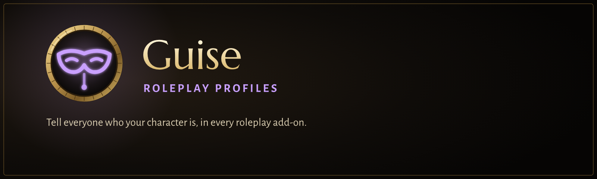

<p align="center">
  
</p>

<p align="center">
  
  
  
</p>

> [!WARNING]
> **Very much a work in progress.** This first stage has passed its test harness but hasn't been played in the game. Expect things to need fixing.

**Guise is a roleplay profile add-on for WoW Forever.** When you meet someone, you see who their character is. When they meet you,
they see yours. Nobody has to ask out of character.

**It works with the other roleplay add-ons.** Guise talks through LibMSP, the same library Total RP 3, MyRolePlay and XRP use, so
their users see your profile and you see theirs, with nothing to set up. See [Other RP add-ons](#other-rp-add-ons).

## What it does

### Your profile
Your RP name (it starts as your Forever first and last name), a prefix and a title, pronouns, a profile icon, and a short **Currently**
line for what you're doing right now. **Details**: age, height, weight, eyes, race and class labels, nickname, house, home, birthplace,
motto and relationship status. Up to five **glances**: an icon, a title and a few lines each, for what anyone would notice. A **description**
with headings and emphasis, and a **history**. An OOC note. Your **status**: In character, Out of character, Looking for contact or Storyteller.

**Boundaries** tell people what's welcome before they walk up: walk-ups, combat, injury, death, romance, crime and loss of control, each
*welcome*, *ask first*, *not for me* or *not shown*. And your experience: new, casual, veteran, or a guide who's happy to help newcomers.

Keep several profiles and switch costumes with one click. Everything saves as you type, and the editor shows your tooltip as others
will see it.

### Meeting people
- **Tooltip:** their RP name in its colour, title, status, pronouns, what they're doing, their OOC note, glance icons, and the first
  line of your own note about them.
- **Glance strip:** your target's glances under the target frame. Hover one to read it. It hides in combat.
- **Character sheet:** one window for anyone, yourself included. At a glance, their description and history, personality traits from
  Total RP 3 profiles, and your private notes and relation (friend, ally, family, rival, enemy).
- **Directory:** everyone you've met with a profile. Search, filter (in your zone, looking for contact, relations), sort, and forget
  people you haven't seen in 90 days.
- **Guise bar:** your status in one click, your sheet, the editor and the directory. Plus a minimap button.

### Being a good neighbour
- A stranger's profile can't put links or clickable codes on your screen. Colours and game icons in descriptions show (other add-ons
  use them), at a sensible size.
- Ignored players are never asked for anything. Hide any profile with one click.
- **Mature profiles** are marked by their owners. Until you turn on "Show mature profiles", you see only their name and status.
- Guise asks only the person you're looking at, only for what changed, and never for the same thing twice in 30 seconds. Someone who
  doesn't answer is left alone for 5 minutes. It sends nothing during encounters or chat lockdown, or in battlegrounds unless you allow it, and it
  never sends chat text.
- When the game hides a name for security reasons (secret values), Guise leaves the game's own tooltip alone.

## Commands

| | |
|---|---|
| `/guise` | your target's sheet, or yours |
| `/guise edit` | edit your profile |
| `/guise dir` | the directory |
| `/guise ic`, `ooc`, `lfc`, `st` | set your status |
| `/guise settings` | settings (also in Options > AddOns > Guise) |
| `/guise bar` | bring the bar back if it's lost |
| `/guise forget First Last` | forget someone |

`/rp` does the same when no other add-on uses it.

## Other RP add-ons

| Add-on | Works with Guise | How |
|---|---|---|
| **Total RP 3** | Yes, both ways | LibMSP. Name and colour, prefix, title, status, currently, OOC, glances, description, history, details, boundaries, experience, relationship, personality traits (read) |
| **MyRolePlay** | Yes, both ways | LibMSP, same fields |
| **XRP** | Yes, both ways | LibMSP, same fields |
| Total RP 2, GnomTEC Badge, flagRSP | If anyone runs them | Old add-ons. Anything still speaking current MSP works |
| **TurtleRP** | No | Turtle WoW only, with no Forever version. Its way of talking (a visible chat channel the add-on types into for you) is something Forever only allows on a key press |
| Macaroni RP | No | Only its Total RP 3 path works. Its MSP fallback (0.3.0) reads `msp.char[name].NA` instead of `.field.NA` and looks people up by first name, so it shows nothing from MyRolePlay, XRP or Guise. It's also built for retail 12.1 |
| rpTags | No | Unmaintained since 2022 and built for retail 9.x. Its MyRolePlay module looks players up as "Name-Realm", which finds nobody on Forever, so it doesn't work there with any profile add-on |
| Anything that reads LibMSP | Yes | Guise's profiles, and the ones it received, are in `msp.char` and `msp.my` like any MSP add-on's |

**One profile add-on per character.** If Total RP 3, MyRolePlay or XRP is running too, Guise steps aside and says so, just as they do
with each other. Two of them would answer every request twice. Turn off the one you don't want in the AddOns list.

## For add-on authors

Read LibMSP's `msp` table as you would for any MSP add-on. Or, for text that's ready to show, use `GuiseAPI`:

```lua
if GuiseAPI and GuiseAPI.IsActive() then
  local p = GuiseAPI.GetProfile("target")       -- a unit or "First Last"
  if p then print(p.name, p.title, p.color, p.status) end
  GuiseAPI.RegisterCallback("MyAddon", function(name) --[[ refresh ]] end)
end
```

`GetProfile` returns a copy with every string safe to show: name, prefix, title, colour, status, pronouns, currently, OOC, details, glances,
and more (the list is at the top of `api.lua`). It respects the player's choices: for a profile they hid, or a mature one they haven't chosen to
see, only the name, colour and status come back, with `restricted = true`. `GuiseAPI.Request(nameOrUnit, "tooltip" | "full")` asks for a profile,
paced like everything else Guise sends.

## Not in this version
RP names in chat, speech colour in emotes, RP names on nameplates, a "nearby" view from a shared zone, and importing a TurtleRP
profile are planned for later stages (see `docs/guise-v1.md` in the project).

## Licence
All rights reserved; see `LICENSE`. The embedded libraries keep their own licences: LibMSP (CC0), Chomp (ISC), ChatThrottleLib and
LibStub (public domain), CallbackHandler (Ace3). The fonts are under the SIL Open Font License.
Guise was inspired by TurtleRP for Turtle WoW but shares none of its code or art.
